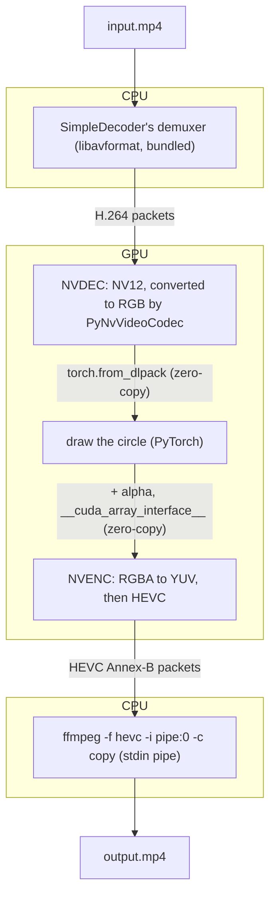

# Studies / Try PyNvVideoCodec and FFmpeg

## Goal

Build a small but complete GPU video pipeline in Python with
[PyNvVideoCodec](https://pypi.org/project/PyNvVideoCodec/): decode a file with
NVDEC, process the frames with PyTorch **without them ever leaving the GPU**,
re-encode them in HEVC with NVENC, and let FFmpeg do the boring part (writing
the MP4 container). Plus a CPU-only path, doing the same with FFmpeg alone, for
machines without an NVIDIA GPU.

The processing is deliberately trivial (a circle drawn in the middle of every
frame): the point is the plumbing, not the effect.

## In short

A video file is compressed. To change its pictures, you have to **decompress**
them (decode), **change** them, then **compress** them again (encode). This
study does exactly that, drawing a circle on every picture.

Graphics cards have small chips dedicated to video: **NVDEC** decompresses,
**NVENC** compresses. The pictures they handle live in the graphics card's own
memory. Copying them to the computer's main memory and back is slow (about 6 MB
per picture, hundreds of times per second), so the whole trick is to keep them
**on the graphics card** from start to end:


Only the compressed video, much smaller, goes in and out. Each step hands the
next one a pointer to the picture in the graphics card's memory, instead of a
copy. To prove it works, the program logs how much data crosses between the
graphics card and the computer (PCIe traffic): about 15 MB/s, against about
1000 MB/s when the pictures are copied back and forth.

The same program also runs **without a graphics card** (`--backend=cpu`): FFmpeg
then decompresses and compresses on the processor, slower (~25 pictures per
second instead of ~250).

The circle itself can be drawn three ways, with identical results:

- **Plain PyTorch**: the drawing code, in Python.
- **ONNX**: the drawing code is exported once to a `.onnx` file, a portable
  description of the computation, then run by ONNX Runtime, without our Python
  code.
- **SafeTensors**: the circle's color is saved alone in a `.safetensors` file
  (just data, no code), and loaded back into our Python code. That's how
  machine-learning models usually ship their weights.
- **TensorRT**: the drawing code is compiled by NVIDIA's TensorRT into an
  "engine", optimized for this exact graphics card (it won't run on another
  one). Graphics card only.

## Usage

```bash
./generate-sample.sh input.mp4                         # 10s 1080p H.264 test pattern
uv run draw-circle run input.mp4 output.mp4                # GPU: NVDEC → PyTorch (CUDA) → NVENC
uv run draw-circle run --backend=cpu input.mp4 output.mp4  # CPU: ffmpeg → PyTorch (CPU) → ffmpeg (libx265)
uv run draw-circle run --radius=0.4 input.mp4 output.mp4   # Bigger circle (relative to the frame height)

# Same, with the circle hidden in an ONNX model, run by ONNX Runtime
uv run draw-circle export-onnx circle.onnx
uv run draw-circle run --onnx-model=circle.onnx input.mp4 output.mp4
uv run draw-circle run --onnx-model=circle.onnx --radius=0.4 input.mp4 output.mp4  # Same model, any radius
uv run draw-circle run --onnx-model=circle.onnx --backend=cpu input.mp4 output.mp4

# Same, with the circle's color stored as weights in a SafeTensors file
uv run draw-circle export-safetensors --color 255 0 0 circle.safetensors
uv run draw-circle run --safetensors-weights=circle.safetensors input.mp4 output.mp4

# Same, compiled by TensorRT for this GPU (GPU backend only)
uv run draw-circle export-tensorrt --color 255 0 0 circle.engine
uv run draw-circle run --tensorrt-engine=circle.engine --radius=0.4 input.mp4 output.mp4

# Gaussian blur instead of the circle: conv2d in plain PyTorch, 8 frames at a time
uv run draw-circle blur input.mp4 output.mp4
uv run draw-circle blur --sigma=8 --batch-size=1 --backend=cpu input.mp4 output.mp4
```

`export-onnx` and `export-tensorrt` also take `--color` (baked into the graph /
engine). Without `--color`, the circle is white.

Requirements: `ffmpeg` and `ffprobe` on the `PATH` (with libx265 for the CPU
backend). For the GPU backend, an NVIDIA GPU with NVENC/NVDEC (tested on an
RTX 500 Ada Laptop, driver 615). The CPU backend runs without any GPU, e.g.
`CUDA_VISIBLE_DEVICES= uv run draw-circle --backend=cpu …`.

## Layout

```
src/try_pynvvideocodec_and_ffmpeg/
├── core.py               # VideoInfo + the Protocols: FrameSource, FrameTransformer, BatchFrameTransformer,
│                         # FrameSink, Backend
├── backends/
│   ├── gpu.py            # GPUBackend: NvDecSource, NvEncSink (PyNvVideoCodec)
│   └── cpu.py            # CPUBackend: FfmpegSource, FfmpegSink (ffmpeg subprocesses)
├── transforms/
│   ├── blur/
│   │   ├── model.py             # Model (as BlurModel): Gaussian blur, two grouped conv2d
│   │   └── without_anything.py  # WithoutAnything (as BlurWithoutAnything): runs it, on batches of frames
│   └── draw_circle/
│       ├── model.py             # Model (as DrawCircleModel): the torch.nn.Module behind ONNX, SafeTensors and TensorRT
│       ├── without_anything.py  # WithoutAnything (as DrawCircleWithoutAnything): plain PyTorch
│       ├── with_onnx.py         # export_onnx(), WithONNX (as DrawCircleWithONNX): ONNX Runtime
│       ├── with_safetensors.py  # export_safetensors(),
│       │                        # WithSafeTensors (as DrawCircleWithSafeTensors): Model + weights
│       └── with_tensorrt.py     # export_tensorrt(), WithTensorRT (as DrawCircleWithTensorRT): TensorRT engine
├── pipeline.py           # run() / run_batched(): source → transform → sink, with timing and PCIe logging
├── monitoring.py         # PCIeMonitor.monitor_pcie() (nvidia-smi dmon)
└── cli/
    ├── main.py           # click group: the `draw-circle` entry point
    └── commands/
        ├── run.py                 # draw-circle run
        ├── blur.py                # draw-circle blur
        ├── export_onnx.py         # draw-circle export-onnx
        ├── export_safetensors.py  # draw-circle export-safetensors
        ├── export_tensorrt.py     # draw-circle export-tensorrt
        └── options.py             # --color, shared by the exports; --backend, shared by run and blur
```

Every frame is an `(H, W, 3)` `uint8` RGB tensor; only its `device` differs
from one backend to the other, so a `FrameTransformer` like `DrawCircleWithoutAnything` works
on both unchanged. A transformer is opened once for the whole video, which is
where anything expensive is loaded (the ONNX Runtime session, the circle mask):

```python
# backend_type: type[Backend], e.g. GPUBackend
# transformer_type: type[FrameTransformer[S]], e.g. DrawCircleWithONNX, with its settings: S
with ExitStack() as stack:  # Exits in reverse order: sink, transformer, source, backend
    backend = stack.enter_context(backend_type.create())
    source = stack.enter_context(backend.open_source(input_path))
    frame_transformer = stack.enter_context(transformer_type.open(source.info, backend.device, settings))
    sink = stack.enter_context(backend.open_sink(output_path, source.info))
    for frame in source:
        sink.write(frame_transformer.transform_frame(frame))
```

The abstractions are `Protocol`s rather than ABCs: the CPU and
GPU classes share no implementation, only a shape. `backends/gpu.py` is imported
lazily by the CLI, so the CPU backend never loads PyNvVideoCodec or initializes CUDA.

Logs are structured (structlog):

```
[info     ] input         codec=h264 fps=30 height=1080 path=input.mp4 width=1920
[info     ] pcie          rx_mb_s=20 tx_mb_s=14
[info     ] pcie.summary  rx_avg_mb_s=18 rx_max_mb_s=21 samples=2 tx_avg_mb_s=20 tx_max_mb_s=26
[info     ] output        fps=244 frames=300 path=output.mp4 seconds=1.23
```

## Pipelines

### GPU (`--backend=gpu`)



Only compressed data crosses the PCIe bus: the H.264 packets going in, and the
HEVC packets coming out.

### CPU (`--backend=cpu`)


`FfmpegSource` reads each frame into one reused buffer, wrapped as a tensor
with `torch.frombuffer` (no copy). Since ffmpeg encodes and muxes itself, it
knows the real timestamps, so none of the B-frame trouble below applies.

## Notes

### Zero-copy, in both directions

- **Decoder → PyTorch**: `SimpleDecoder(..., output_color_type=OutputColorType.RGB)`
  yields `DecodedFrame`s that implement DLPack, so `torch.from_dlpack(frame)`
  gives a `(H, W, 3)` `uint8` tensor that *points* to the decoder surface.
- **PyTorch → Encoder**: `CreateEncoder(..., "ABGR", ...)` takes RGBA, and NVENC
  converts it to YUV itself. Despite the name, the byte order in memory is
  R, G, B, A (NVENC names the format as a little-endian 32-bit word).
  `PyNvEncoder.Encode()` is documented as taking "any object that implements
  `__cuda_array_interface__`", but it is pickier than that:
  1. A raw `torch.Tensor` fails with `Tensor.__dlpack__() takes 1 positional
     argument but 2 were given`: the encoder tries DLPack first and passes
     `stream` positionally. Wrapping the tensor in an object that only exposes
     `__cuda_array_interface__` (`CudaArray`) avoids it.
  2. For ABGR, it wants an object whose `.cuda()` method returns a **single**
     CAI object of shape `(H, W, 4)` (`RGBAFrame`). A bare CAI object (in every
     shape I tried) or a list fails with an obscure "incorrect usage of CPU
     input buffer" error. Each input format has its own convention: for NV12,
     `.cuda()` must instead return a list of one object per plane (luma as
     `(H, W, 1)`, chroma as `(H / 2, W / 2, 2)`).

  The `.cuda()` requirement is only documented in the
  [Programming Guide, "Basic Encoding Workflow"](https://docs.nvidia.com/video-technologies/pynvvideocodec/pynvc-api-prog-guide/using_pynvvideocodec_apis.html)
  ("For GPU buffer mode, input objects must implement the `cuda()` method
  exposing CUDA Array Interface"), with an NV12-only `AppFrame` example. The
  [Encoder API reference](https://docs.nvidia.com/video-technologies/pynvvideocodec/pynvc-api-reference/encoder.html)
  does not mention it, and neither documents the plane shapes for other formats
  (the ABGR shape above was found by trial and error).

### Synchronization

PyTorch launches its kernels asynchronously, and NVENC copies its input on its
own CUDA stream. Without `torch.cuda.current_stream().synchronize()` before
`Encode()`, NVENC read the output tensor before it was written. Because
PyTorch's caching allocator reuses the same block for every frame, the result
was no garbage but a subtle **off-by-one**: every encoded frame was actually the
previous one.

The same sync also protects the decoder side: the tensor from `from_dlpack`
aliases a decoder surface that will be recycled for later frames.

### No B-frames

An Annex-B elementary stream has no timestamps. When FFmpeg reads one with
`-f hevc -framerate …`, it assumes frames come in display order. With B-frames
(on by default for NVENC HEVC), decode order is different, and the MP4 ends up
with misordered frames and negative timestamps (the first frames hidden behind
an edit list). Hence `bf=0` on the encoder.

To keep B-frames, the container needs real PTS/DTS: PyNvVideoCodec ships its
own `FFmpegMuxer` that rebuilds them from the source packets
(`RecordSourceVideoPacket` / `MuxVideoPacket` / `Finalize`), and it can also
copy the audio through, which this pipeline drops.

### The circle in an ONNX model

`DrawCircleModel` is the circle as a `torch.nn.Module`, exported with
`torch.onnx.export(..., dynamo=True)`. `DrawCircleWithONNX` is a
`FrameTransformer` like `DrawCircleWithoutAnything`, so it plugs into both backends unchanged:

- On the **GPU**, ONNX Runtime's `CUDAExecutionProvider` reads and writes the
  tensors' memory directly through **IO binding** (`bind_input` / `bind_output`
  with `data_ptr()`). Without it, inputs and outputs would be NumPy arrays, and
  every frame would go through the host. Like NVENC, ONNX Runtime runs on its
  own CUDA stream, so the PyTorch stream is synchronized before the run.
- On the **CPU**, `session.run()` with NumPy views of the tensors (no copy).

Outputs are bit-identical to `DrawCircleWithoutAnything` on both backends (checked
at radii 0.1, 0.3 and 0.45, with a single exported model).

The radius is a **model input** (`radius_ratio`, a 0-d `float32` tensor), not a
constant baked in at export time: one `.onnx` file draws any radius, chosen with
`run --radius`. `WithONNX.open()` puts that tensor on the frames' device once,
and it is bound next to the frame on every run (by device pointer on the GPU, so
it never crosses the bus either). It could even change from frame to frame.

Things that were not obvious:

- `onnxruntime-gpu` 1.31 is built against CUDA 13, like `torch` 2.14 (cu130),
  and `ort.preload_dlls()` loads the CUDA libraries from the `nvidia-*` wheels
  PyTorch already depends on: nothing else to install.
- With dynamic height and width, `frame.shape[0] / 2` is a symbolic Python
  float, and the exporter fails on it (`float() argument must be a string or a
  real number, not 'SymbolicTensor'`). Deriving the sizes as tensors
  (`y[-1] + 1` from the `arange`) avoids it.
- ONNX Runtime places a few shape-related nodes (`Cast`, `Squeeze`, on 4 to 8
  bytes) on the CPU, and warns about it; its profiler shows every node touching
  frame-sized data on CUDA. `nvidia-smi dmon` reports ~36 MB/s to the GPU with
  ONNX against ~14 MB/s with plain PyTorch, but the GPU's own counters (Nsight
  Systems GPU metrics, sampled continuously) only show ~6% more PCIe traffic,
  and Nsight shows the same 13 KB of host-to-device copies: `nvidia-smi`
  samples a short window once per second, which per-frame bursts skew. Not a
  real difference, then.
- On the CPU, ONNX Runtime is ~2.5x slower than `DrawCircleWithoutAnything` (10 vs 25 fps):
  the model recomputes the mask for every frame, whereas `DrawCircleWithoutAnything` computes
  it once in `open()`.

### The circle's color in a SafeTensors file

SafeTensors holds no computation, only named tensors (a JSON header, then raw
bytes): unlike ONNX, it needs the model's code. So `Model` gets some state, the
circle's `color` (a `uint8` buffer of shape `(3,)`), and the file is just its
`state_dict()`, 75 bytes:

```
{"color":{"dtype":"U8","shape":[3],"data_offsets":[0,3]}}  + 3 bytes: 255 0 0
```

`WithSafeTensors.open()` builds a fresh `Model()`, loads the file **directly on
the frames' device** (`load_file(path, device="cuda")`: no pickle, unlike
`torch.save`, and no CPU detour), and swaps the tensors in with
`load_state_dict(..., assign=True)` (without `assign`, they would be copied into
the model's own CPU buffers). The model then runs in plain PyTorch, under
`torch.inference_mode()`.

The same `Model` is behind both exports: ONNX bakes the color into the graph as
a constant (an initializer), SafeTensors stores it alone. Outputs are
bit-identical across `WithoutAnything`, `WithONNX` and `WithSafeTensors` (white),
and between `WithONNX` and `WithSafeTensors` (red), on both backends.

### The circle compiled by TensorRT

TensorRT is NVIDIA's inference compiler: from the ONNX model, it builds an
**engine**, the same computation optimized for one GPU model and one TensorRT
version (an engine built here won't load anywhere else, and the error says so).
`export-tensorrt` exports `Model` to ONNX in a temporary directory, then builds
the engine (35 KB, a few seconds) with an optimization profile for frames from
64×64 to 3840×2160, tuned for 1920×1080.

`WithTensorRT.open()` loads the engine, sets the frame size once (all frames of a
video have the same), and binds the radius tensor. `transform_frame` then hands
TensorRT the raw GPU addresses of the input frame and of a fresh output tensor
(`set_tensor_address`, like ONNX Runtime's IO binding), and enqueues the engine
on its own CUDA stream (`execute_async_v3`), ordered with PyTorch's through
`wait_stream()`: GPU-side waits, the CPU doesn't block.

Things that were not obvious:

- TensorRT has no `uint8` support for `Where` ("Found unsupported input type of
  UINT8"): `TensorRTModel` runs the `where` in `int32` and casts back. Same
  values, so the output stays bit-identical; ONNX and SafeTensors keep the
  `uint8` `Model`.
- `tensorrt-cu13` 11.4 matches PyTorch's CUDA 13. The `tensorrt` module only
  re-exports a compiled one (`tensorrt_bindings.tensorrt`), invisible to type
  checkers: importing that one directly gives an untyped module instead of an
  error on every `trt.` attribute.
- TensorRT runs on its own CUDA stream. On PyTorch's (CUDA's legacy default stream, which
  implicitly syncs with every other stream), it warns "Using default stream in
  enqueueV3() may lead to performance issues" and adds `cudaStreamSynchronize()`
  calls. The two streams are ordered with `wait_stream()`, on the GPU, without
  blocking the CPU.
- GPU only: `run --backend=cpu --tensorrt-engine=…` is rejected.

Outputs are bit-identical to plain PyTorch, ONNX and SafeTensors (same MD5 over
all decoded frames, white and red, radius 0.2 and 0.45), at the same speed: the
GPU isn't the bottleneck.

### Blur with `conv2d`

`draw-circle blur` runs a Gaussian blur, written with `torch.nn.functional`
only (no torchvision): the kernel is `exp(-x² / 2σ²)` over `[-⌈3σ⌉, ⌈3σ⌉]`,
normalized to sum to 1, and stored as the `Model`'s buffer.

- **Separable**: the 2D Gaussian is the outer product of the 1D one with
  itself, so `Model` runs two `conv2d`, a `(1, K)` then a `(K, 1)` kernel: 2K
  multiplications per pixel instead of K² (50 instead of 625 at σ=4).
- **`groups=3`**: each channel is convolved with its own copy of the kernel, so
  R, G and B don't mix.
- **Edges**: `F.pad(mode="replicate")` then `conv2d` without padding. With
  `conv2d`'s own `padding=` (zeros), the borders would fade to black.
- **Dtype**: `float16` on the GPU, `float32` on the CPU (no fast `float16`
  convolution there). Outputs are within 1 of a `float64` shifted-sum reference.

It's the only **batched** transformer (`BatchFrameTransformer`):
`transform_frames` takes `(N, H, W, 3)` and every operation runs on the N
frames at once. `run_batched()` copies decoded frames into one reused `(N, H,
W, 3)` `uint8` buffer (`--batch-size`, 8 by default): the decoder recycles its
surfaces, so a frame can't be kept until its batch is full without a copy. On
the GPU, that copy is synchronized before the next frame is decoded.

Batching doesn't pay here: on the 10s 1080p clip, 182 fps with
`--batch-size=1`, 145 with 8, 132 with 32. As for the circle, the GPU isn't
the bottleneck, and batching serializes the stages (decode N frames, blur them,
encode them) where one frame at a time interleaves them. PCIe traffic stays at
~15 MB/s: frames never leave the GPU. On the CPU, ~10 fps.

### Throughput

| Input         | Backend | Frames | Time   | FPS  |
|---------------|---------|--------|--------|------|
| 1080p30, 10s  | `gpu`   | 300    | 1.2s   | ~245 |
| 1080p30, 10s  | `cpu`   | 300    | 12.2s  | ~25  |
| 1080p30, 10s  | `gpu` + ONNX | 300 | 1.4s  | ~215 |
| 1080p30, 10s  | `cpu` + ONNX | 300 | 29.6s | ~10  |
| 1080p30, 100s | `gpu`        | 3000 | 11.2s | ~270 |
| 1080p30, 100s | `gpu` + ONNX | 3000 | 11.2s | ~270 |
| 1080p30, 100s | `gpu` + TensorRT | 3000 | 11.0s | ~270 |

The CPU backend is bound by libx265 (software HEVC encoding). On the GPU, Nsight
Systems shows ~0.8 ms of CUDA kernels per frame out of ~3.7 ms: the GPU waits on
the Python side (one synchronization per frame, before NVENC) most of the time.

Two GPU costs Nsight pointed at are gone: the `torch.cat` adding the alpha
channel for NVENC (~350 µs per frame; `NvEncSink` now keeps one RGBA buffer, alpha
set once, and only fills its RGB channels) and `WithoutAnything`'s
`frame.clone()` (a 6 MB copy per frame; now a single `torch.where`). GPU time per
frame went from 868 to 792 µs, but the frame rate didn't move (~270 fps on the
100s clip): the GPU was never the bottleneck.

### Why colors shift on the GPU

On a pure green bar of the test pattern (input `(0, 255, 1)`), the CPU output
gives `(1, 254, 0)`, but the GPU output `(18, 253, 8)`.

Videos are stored in **YUV** (brightness + two color differences), not RGB. The
formula between the two is a standard: **BT.601** (SD TV), **BT.709** (HD TV),
BT.2020 (UHD / HDR), each in *limited* (Y in 16-235) or *full* (0-255) range. A
file is supposed to say which one it uses (its "color tags"); when it doesn't,
every tool guesses, and they don't all guess the same way:

| Who | RGB ⇄ YUV for an untagged file | Measured how |
|---|---|---|
| ffmpeg (`generate-sample.sh`, CPU backend) | always BT.601 | its defaults |
| PyNvVideoCodec decoder (YUV → RGB) | BT.601 for 640×480, BT.709 for 1920×1080; follows the tags when there are some | its RGB output vs ffmpeg's, matrix by matrix: 0.35 mean difference with BT.709 |
| PyNvVideoCodec encoder (RGBA → YUV, before NVENC) | BT.601 up to 768×576, BT.709 as soon as the width is above 768 or the height above 576 | raw YUV of solid colors vs each formula, at 20 sizes: exact match every time |
| NVENC output | writes no matrix tag (`color_space=unknown`) | `ffprobe` |

Both conversions are CUDA kernels inside PyNvVideoCodec, not the NVDEC / NVENC
hardware: Nsight Systems shows `YuvToRgbKernel` after decoding and
`ConvertRGB2YUV` before encoding, each preceded by a tiny
`cudaMemcpyToSymbol` (about 20 bytes, twice per frame), most likely the
matrix coefficients. Neither the decoder nor the encoder exposes an option to pick the matrix
(`CreateEncoder` only knows `preset`, `tuning_info`, `bf`, `gop`, rate control…).
So, on the first (untagged) 1080p sample, two guesses went wrong:


The fix is to tag everything, with the matrix really used:

- `generate-sample.sh` converts to YUV with BT.709 and tags the file as such
  (`scale=out_color_matrix=bt709,setparams=…`: the encoder takes the primaries
  and transfer tags from the frames, so `-color_primaries` alone isn't enough).
- The GPU backend tags its output, when muxing and without re-encoding, with
  `-bsf:v hevc_metadata=…matrix_coefficients=…`: BT.601 or BT.709 depending on
  the size, following the measured rule (`rgb_to_yuv_standard()` in
  `backends/gpu.py`).
- The CPU backend encodes with BT.709 and tags it too.

Result, mean RGB difference between input and output over all 300 frames:
0.4 (GPU) and 1.1 (CPU, mostly libx265 compression around edges); the green bar
comes back as `(1, 254, 0)` instead of `(18, 253, 8)`. A 640×480 BT.601 clip
comes out tagged BT.601 (`smpte170m`).

Careful when measuring: ffmpeg's `psnr` filter reported 18 dB between the GPU
and CPU outputs although their pixels only differ by 0.9 on average. Comparing
the decoded RGB pixels directly is more reliable when the two files carry
different tags.

### Checking that frames stay on the GPU

**PCIe traffic** is the end-to-end check: it sees every copy, including the
ones made inside PyNvVideoCodec. The pipeline runs `nvidia-smi dmon -s t` in the
background (`PCIeMonitor.monitor_pcie()`) and logs a sample every second, then a summary:

```
[info     ] pcie          rx_mb_s=20 tx_mb_s=14
...
[info     ] pcie.summary  rx_avg_mb_s=18 rx_max_mb_s=21 samples=2 tx_avg_mb_s=20 tx_max_mb_s=26
```

On a 100s clip, in MB/s:

| | `rxpci` (to GPU) | `txpci` (from GPU) |
|---|---|---|
| Idle                                               | 0     | 0     |
| `--backend=gpu`                                    | ~14   | ~15   |
| `--backend=cpu`                                    | 0     | 0     |
| NVDEC/NVENC, frames processed in host memory (*)   | ~1000 | ~1000 |

(*) An earlier version of the CPU backend kept NVDEC/NVENC but asked
PyNvVideoCodec for frames in host memory (`use_device_memory=False`,
`usecpuinputbuffer=True`): that is what raw frames cost on the bus, at 110 fps,
1080p RGB out (~680 MB/s) and RGBA back in (~910 MB/s). On the GPU backend,
what is left is in the order of the H.264 / HEVC bitstreams at ~9x real-time,
plus driver overhead.

**`torch.cuda.set_sync_debug_mode("error")`** makes PyTorch raise on
synchronizing operations, which catches an accidental `.cpu()`, `.item()` or
CPU tensor sent to the GPU while developing. Limits: it is a prototype, it only
sees PyTorch's own operations (not PyNvVideoCodec's), and it also raises on the
pipeline's deliberate `synchronize()`, so it is not left on.

**Nsight Systems** (`nsys profile --trace=cuda`) lists every CUDA memory copy
with its direction and size. On the 10s clip (300 frames), GPU backend:

| | Host → GPU | GPU → host | GPU → GPU |
|---|---|---|---|
| `WithoutAnything` | 608 copies, 13 KB | 1 copy, a few bytes | 300 copies, 2.5 GB (600, 4.4 GB, before removing its `clone()`) |
| `WithONNX` | 613 copies, 13 KB | none | 300 copies, 2.5 GB |
| `WithSafeTensors` | 610 copies, 13 KB | none | 300 copies, 2.5 GB |

No frame ever crosses PCIe. The tiny host → GPU copies are the color-conversion
coefficients (`cudaMemcpyToSymbol`, see the colors section). The GPU → GPU
copies stay in the GPU's memory, but they are copies all the same:

- One 8.3 MB copy per frame in every variant: PyNvVideoCodec copies our RGBA
  tensor into its own input buffer (`cuMemcpy2DAsync`) before NVENC reads it.
  So the hand-off to the encoder is zero-copy over PCIe, not inside the GPU.
- `WithoutAnything` used to add a 6.2 MB copy per frame, its `frame.clone()`:
  it now uses `torch.where`, like the model behind ONNX and SafeTensors.

Kernel launches per frame: ~6 with `WithoutAnything` (the mask is computed once),
~19 with `WithSafeTensors` and ~21 with `WithONNX` (the model recomputes the mask
for every frame).

Run as root (`sudo nsys profile --gpu-metrics-devices=all …`; GPU counters
require profiling permissions, `ERR_NVGPUCTRPERM` otherwise), Nsight also
samples the GPU's PCIe throughput continuously: ~0.7% of the link to the GPU
and ~1.1% from it, the same with and without ONNX.
