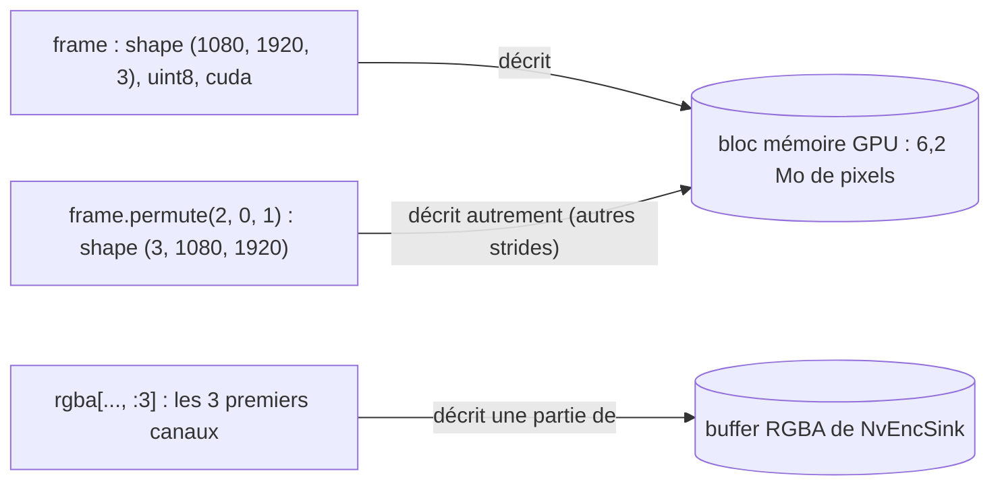
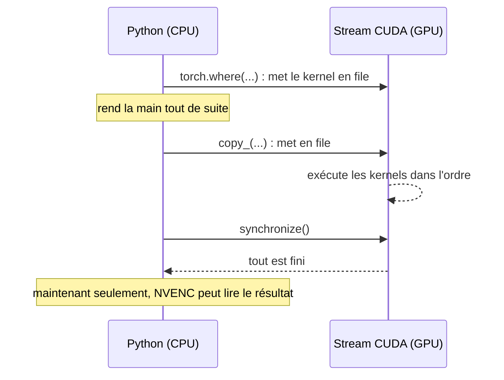
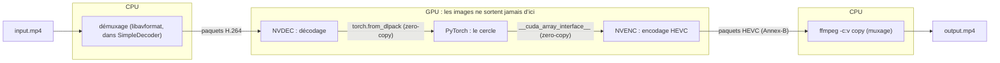
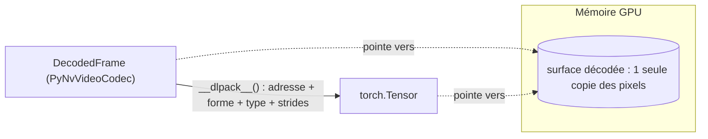
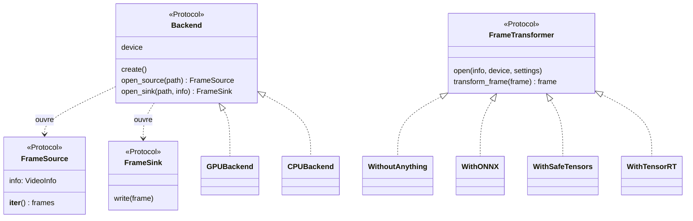
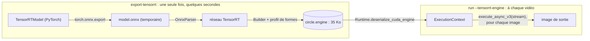
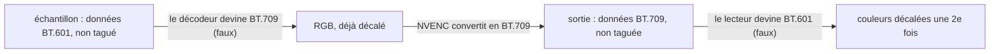

# Tech retro : un pipeline vidéo 100 % GPU en Python

> PyNvVideoCodec + PyTorch + FFmpeg : décoder, transformer et réencoder une vidéo sans que les images quittent la carte graphique.

Durée visée : **~30 min + questions**. Les durées indiquées par section sont des repères.

---

## 1. Le contexte (5 min)

- **La question de départ** : peut-on construire en Python un pipeline vidéo complet sur GPU, sans que les images transitent par la RAM ?
- **Le principe** : une vidéo est compressée. Pour modifier ses images, il faut les **décoder**, les **transformer**, puis les **réencoder**.
- **Le traitement est volontairement idiot** : dessiner un cercle au milieu de chaque image (puis un flou gaussien). Le sujet, c'est la plomberie, pas l'effet.
- **Pourquoi ça compte** : une image 1080p en RGB pèse ~6 Mo. À 250 images/s, la faire faire l'aller-retour GPU ↔ CPU coûte ~1 Go/s sur le bus PCIe.

### Rappel : tenseurs et PyTorch (3 min)

Tout le projet manipule des **tenseurs** PyTorch. Il faut avoir quelques notions en tête pour suivre la suite.

**Un tenseur = un bloc de mémoire + une description de ce bloc**

- `shape` : les dimensions. Une image 1080p, c'est `(1080, 1920, 3)` : hauteur, largeur, canaux R/G/B. Un batch de 8 images, c'est `(8, 1080, 1920, 3)`.
- `dtype` : le type des éléments. Ici `uint8`, un octet par canal, de 0 à 255. Une image fait donc 1080 × 1920 × 3 ≈ **6,2 Mo**.
- `device` : où vit la mémoire, `cpu` (la RAM) ou `cuda` (la mémoire de la carte graphique).
- `strides` : de combien d'éléments avancer pour passer au suivant dans chaque dimension. C'est ce qui permet les *vues*.



**Vues et copies**

- `permute`, `view`, `unsqueeze` et le découpage `x[..., :3]` créent une **vue** : nouvelle description, même mémoire, aucune copie. Le flou s'en sert pour passer de `(N, H, W, 3)` à `(N, 3, H, W)`, la forme qu'attend `conv2d`.
- `clone()`, `contiguous()` (si la mémoire n'est pas déjà dans l'ordre) et `copy_()` **copient**.
- `.to("cuda")` et `.cpu()` copient **à travers le bus PCIe**. C'est exactement ce que le projet évite.

**Calcul vectorisé et broadcasting**

- On n'écrit jamais de boucle Python sur les pixels. Une opération s'applique à tout le tenseur d'un coup, en un seul **kernel** GPU (un programme exécuté en parallèle par des milliers de threads).
- Le masque du cercle combine `x`, de forme `(1, W)`, et `y`, de forme `(H, 1)`. PyTorch les étend tout seul en `(H, W)` : c'est le *broadcasting*.
- `torch.where(mask, couleur, frame)` choisit ensuite, pixel par pixel, entre la couleur et l'image.

**Sur GPU, tout est asynchrone**



- Un appel PyTorch sur `cuda` **met un kernel en file** sur un *stream* CUDA (une file d'attente ordonnée), puis rend la main immédiatement.
- Deux streams différents ne s'attendent pas entre eux. NVENC, ONNX Runtime et TensorRT ont chacun le leur : il faut les ordonner (`synchronize()`, `wait_stream()`). C'est l'origine du piège 5.2.
- `.item()`, `.cpu()` ou `print(tensor)` forcent une synchronisation cachée.

**L'allocateur de cache**

PyTorch ne rend pas la mémoire GPU libérée au driver : il la garde et la réutilise pour l'allocation suivante de même taille. C'est rapide, mais c'est pour ça que le bug 5.2 donnait l'image *précédente* au lieu de pixels aléatoires. C'est aussi pour ça qu'il faut `record_stream()` quand un autre stream utilise un tenseur (voir TensorRT).

**`torch.nn.Module` : du code + un état**

- Le code, c'est la méthode `forward()` : le calcul.
- L'état, ce sont les *paramètres* et *buffers*, réunis dans le `state_dict()`. Pour le cercle, c'est la couleur ; pour le flou, le noyau gaussien.
- C'est cette séparation qu'exploitent les exports : ONNX emporte le code **et** l'état, SafeTensors uniquement l'état.
- `torch.inference_mode()` désactive le suivi des gradients, inutile puisqu'on n'entraîne rien.

## 2. L'architecture (8 min)

### Le pipeline GPU



### Le pipeline CPU, pour comparer


- **NVDEC / NVENC** : les puces dédiées au décodage / encodage vidéo sur les cartes NVIDIA.
- **Zero-copy** entre les étapes : on se passe des pointeurs vers la mémoire GPU, jamais des copies. DLPack sert à l'entrée, `__cuda_array_interface__` à la sortie (détails plus bas).
- **FFmpeg** ne fait que la partie ennuyeuse : écrire le conteneur MP4, sans réencoder.
- **Un backend CPU** de repli (FFmpeg seul + libx265), pour les machines sans GPU NVIDIA.

### Zero-copy : DLPack et `__cuda_array_interface__` (2 min)

**Le problème** : PyNvVideoCodec, PyTorch, ONNX Runtime ou CuPy ont chacun leur propre type de tableau. Pour qu'une bibliothèque lise la mémoire GPU d'une autre **sans copier**, il faut lui décrire ce bloc dans un format commun :

- l'**adresse** du premier octet en mémoire GPU ;
- la **forme**, par exemple `(1080, 1920, 3)` ;
- le **type** des éléments, par exemple `uint8` ;
- les **strides**, c'est-à-dire de combien d'octets avancer pour passer à la ligne ou au pixel suivant ;
- le **device** sur lequel vit la mémoire.

Deux protocoles standard font exactement ça. Dans les deux cas, seule cette description change de mains ; les ~6 Mo de pixels ne bougent pas.



| | **DLPack** | **`__cuda_array_interface__`** (CAI) |
|---|---|---|
| Origine | standard ouvert, au niveau C (structure `DLTensor`), repris par le *Python Array API* | protocole Python introduit par Numba |
| Devices | CPU, CUDA, ROCm… | CUDA uniquement |
| Forme côté Python | `x.__dlpack__(stream=...)` renvoie une *capsule* opaque, `x.__dlpack_device__()` dit où vit la mémoire | un simple attribut `dict` : `{"data": (adresse, lecture_seule), "shape", "typestr": "\|u1", "strides", "version", ...}` |
| Côté consommateur | `torch.from_dlpack(x)` | la bibliothèque lit le `dict` |
| Durée de vie | la capsule embarque une fonction de libération (*deleter*) : le producteur sait quand le consommateur a fini | aucune gestion : c'est à l'appelant de garder l'objet source en vie |
| Streams CUDA | le consommateur passe son stream, le producteur peut l'ordonner | champ `stream` optionnel (version 3 du protocole) |

**Dans le projet** :

- **Décodeur → PyTorch, via DLPack** : `torch.from_dlpack(frame)` donne un tenseur qui pointe **directement sur la surface de NVDEC**. Preuve dans les logs en `-v` : le `data_ptr` du tenseur est l'adresse de la surface. Contrepartie : le décodeur recycle ses surfaces, donc une image n'est valide que jusqu'à la suivante (d'où la copie obligatoire pour le batching).
- **PyTorch → encodeur, via CAI**, avec deux enveloppes (`backends/gpu.py`) :
  - `CudaArray` n'expose *que* `__cuda_array_interface__`. L'encodeur essaie DLPack en premier et passe `stream` en argument positionnel, ce que `torch.Tensor.__dlpack__` refuse.
  - `CudaArray` garde aussi une référence vers le tenseur, puisque CAI ne gère pas la durée de vie.
  - `RGBAFrame` ajoute la méthode `.cuda()` que l'encodeur attend en plus (→ piège 5.1).
- **ONNX Runtime et TensorRT** : là, ni l'un ni l'autre protocole n'est utilisé. On leur passe directement le pointeur brut, `tensor.data_ptr()` (IO binding, `set_tensor_address`). C'est la même idée, sans aucun garde-fou.
- **Aucun des deux protocoles ne synchronise à notre place** : partager l'adresse ne garantit pas que les écritures soient terminées (→ piège 5.2, l'image décalée de un).

### Conteneur ≠ codec : démuxer et muxer (1 min)

Un fichier `.mp4` contient deux choses distinctes, et on les confond souvent :

| | Rôle | Dans le projet |
|---|---|---|
| **Conteneur** (MP4, MKV…) | la *boîte* : les pistes (vidéo, audio), les **timestamps** de chaque image, un index pour se déplacer dans le fichier, des métadonnées | MP4 en entrée et en sortie |
| **Codec** (H.264, HEVC…) | la *méthode de compression* des images elles-mêmes | H.264 en entrée, HEVC en sortie |

Image possible : le conteneur, c'est l'enveloppe ; le codec, c'est la langue dans laquelle la lettre est écrite.

- **Démuxer** : ouvrir la boîte et en extraire les **paquets compressés** d'une piste, avec leurs timestamps. On ne décompresse rien.
- **Muxer** : l'inverse, ranger des paquets compressés dans une boîte.
- **Décoder / encoder** : c'est là qu'on décompresse et compresse vraiment, et c'est ce qui coûte cher.


Seules les étapes du milieu (décoder, transformer, encoder) touchent les images brutes, et ce sont elles qui restent sur le GPU.

Dans le pipeline GPU :

- **Démuxage, sur le CPU** : `SimpleDecoder` de PyNvVideoCodec embarque son propre démuxeur (libavformat, la bibliothèque de FFmpeg). Il lit le MP4 et envoie les paquets H.264 à NVDEC. C'est léger, car seuls les octets compressés traversent le bus.
- **Muxage, sur le CPU** : NVENC sort un flux HEVC « nu », sans conteneur. On le passe à `ffmpeg -f hevc -i pipe:0 -c:v copy` par un pipe. `-c copy` veut dire **aucun réencodage** : FFmpeg ne fait que remettre les paquets dans un MP4.
- Conséquence : on ne fait que remballer, et la piste audio n'est pas recopiée, donc la sortie n'a plus de son.

### HEVC en deux minutes (2 min)

- **HEVC = H.265**, le successeur de H.264 (AVC). À qualité égale, il vise environ **moitié moins de débit**, au prix d'un encodage plus coûteux. C'est pour ça qu'on veut le faire faire à NVENC.
- **Le principe** commun aux deux : découper l'image en blocs (jusqu'à 64×64 en HEVC, contre 16×16 en H.264). Ensuite, prédire chaque bloc à partir de ce qui est déjà connu, et n'encoder que l'erreur de prédiction.
- **Trois types d'images** :
  - **I** : l'image est complète, autonome (un point d'entrée).
  - **P** : l'image est prédite à partir d'images *passées*.
  - **B** : l'image est prédite à partir d'images passées **et futures**. L'encodeur doit donc les émettre dans le désordre : l'**ordre de décodage diffère de l'ordre d'affichage**. Ce sont les timestamps du conteneur (PTS / DTS) qui permettent de remettre les images dans l'ordre (→ piège 5.3).

  ```mermaid
  flowchart LR
      I0["I0 (autonome)"]
      B1["B1"] -- référence --> I0
      B1 -- référence --> P3
      B2["B2"] -- référence --> I0
      B2 -- référence --> P3
      P3["P3"] -- référence --> I0
  ```

  - Ordre d'affichage : I0, B1, B2, P3.
  - Ordre de décodage : I0, **P3**, B1, B2 (P3 doit être décodée avant les B qui en dépendent).
- **Annex-B**, le format « brut » que sort NVENC :
  - le flux est découpé en **unités NAL** séparées par des *start codes* (`00 00 01`) ;
  - les paramètres du flux (VPS / SPS / PPS) y sont inclus ;
  - il n'y a **aucun timestamp**.

  Le MP4 range ces mêmes données autrement : chaque unité est préfixée par sa longueur, et les paramètres vont dans l'en-tête de la piste. FFmpeg fait la conversion au moment du muxage.
- **`-tag:v hvc1`** : c'est la variante de l'étiquette MP4 où les paramètres sont dans l'en-tête de la piste. Elle est exigée par QuickTime / Safari, alors que `hev1`, la valeur par défaut de FFmpeg, est refusée par certains lecteurs.
- **VUI** (*Video Usability Information*) : une zone de métadonnées du SPS, qui contient notamment la **matrice de couleur** utilisée. Le filtre `-bsf:v hevc_metadata` la réécrit sans réencoder (→ piège 5.4).
- **Réglages NVENC utilisés** : `codec="hevc"`, `preset="P4"` (le juste milieu entre P1, le plus rapide, et P7, la meilleure qualité) et `bf=0` (pas de B-frames).

### Le code

- Abstractions en `Protocol` (`core.py`) : `Backend`, `FrameSource`, `FrameTransformer`, `FrameSink`. Le CPU et le GPU ne partagent aucune implémentation, seulement une forme.


- Une image = un tenseur `(H, W, 3)` `uint8`. Seul son `device` change d'un backend à l'autre, donc un même transformer marche partout.
- Les ressources sont ouvertes via un `ExitStack` (`pipeline.py`) : fermeture garantie dans l'ordre inverse.
- `backends/gpu.py` est importé paresseusement : le backend CPU n'initialise jamais CUDA.

## 3. Démo (3 min)

```bash
./generate-sample.sh input.mp4
uv run draw-circle run input.mp4 output-gpu.mp4
uv run draw-circle run --backend=cpu input.mp4 output-cpu.mp4
uv run draw-circle blur input.mp4 output-blur.mp4
```

- Montrer les logs : `fps`, et surtout `pcie rx_mb_s / tx_mb_s`.
- Option : `./demo.sh` lance toutes les combinaisons backend × transformer.

## 4. Une transformation, quatre façons de l'exécuter (6 min)

Même cercle, résultats **bit à bit identiques** (vérifiés par MD5 sur toutes les images) :

| Variante | Ce qui est livré | Ce qu'on apprend |
|---|---|---|
| PyTorch « nu » | du code Python | la référence |
| **ONNX** | le calcul exporté dans un `.onnx`, exécuté par ONNX Runtime | IO binding pour rester sur le GPU ; le rayon est une *entrée* du modèle, pas une constante |
| **SafeTensors** | uniquement les poids (la couleur : 3 octets, fichier de 75 octets) | c'est comme ça que les modèles de ML distribuent leurs poids ; chargement direct sur le GPU |
| **TensorRT** | un « engine » compilé pour *cette* carte précise | ne tourne nulle part ailleurs ; pas de `uint8` pour `Where` → passage en `int32` |

Bonus : le **flou gaussien** en `conv2d` séparable (2K multiplications par pixel au lieu de K²), avec du batching.

### Zoom sur TensorRT (3 min)

**Ce que c'est** : le **compilateur d'inférence** de NVIDIA. Il prend un graphe de calcul (ici, un `.onnx`) et produit un **engine**, un binaire optimisé pour **un modèle de GPU précis** et **une version de TensorRT précise**.



**Ce que fait le build** :

- Il **fusionne** les opérations : plusieurs nœuds du graphe deviennent un seul kernel, donc moins d'allers-retours en mémoire.
- Il **mesure** plusieurs implémentations possibles de chaque opération sur la carte présente, et garde la plus rapide. C'est pour ça que l'engine n'est pas portable.
- Il peut **réduire la précision** (FP16, INT8). Ce n'est pas utilisé ici : on reste sur des résultats bit à bit identiques.
- Il fige un **profil de formes** : images de 64×64 à 3840×2160, optimisé pour 1920×1080. En dehors de cet intervalle, l'engine refuse l'entrée.

**ONNX Runtime ou TensorRT ?**

| | ONNX Runtime | TensorRT |
|---|---|---|
| Principe | **exécute** le graphe ONNX, via un *execution provider* (CPU, CUDA…) | **compile** le graphe en engine |
| Portabilité | le même `.onnx` tourne partout, CPU compris | un engine par couple GPU / version de TensorRT |
| Préparation | aucune | un build de quelques secondes (des minutes sur un vrai modèle) |
| Dans le projet | CPU et GPU | GPU seulement (`--backend=cpu` est refusé) |

**L'exécution, image par image** (`with_tensorrt.py`) :

1. **Une fois par vidéo** :
   - `set_input_shape` fixe la taille des images (elle ne change pas au cours d'une vidéo) ;
   - le tenseur du rayon est placé sur le GPU, et son adresse est donnée une fois pour toutes.
2. **Pour chaque image** :
   - PyTorch alloue la sortie (`torch.empty_like`) ;
   - on donne à TensorRT les **adresses brutes** de l'entrée et de la sortie (`set_tensor_address(..., tensor.data_ptr())`). Rien n'est copié.
3. **Sur son propre stream CUDA**, avec trois précautions :
   - `wait_stream()` dans les deux sens ordonne TensorRT et PyTorch **côté GPU**, sans bloquer le CPU ;
   - `record_stream()` prévient l'allocateur de cache de PyTorch que la sortie est encore utilisée par un autre stream ;
   - sans stream dédié, TensorRT se retrouve sur le stream par défaut « legacy », qui se synchronise avec tous les autres. Il prévient alors : « Using default stream in enqueueV3() may lead to performance issues ».

**Les pièges** :

- **Pas de `uint8` pour `Where`** (« Found unsupported input type of UINT8 ») : `TensorRTModel` fait le `where` en `int32`, puis repasse en `uint8`. Les valeurs sont les mêmes, donc la sortie reste identique.
- **Engine non portable** : chargé sur une autre carte ou avec une autre version de TensorRT, il est refusé, avec un message clair.
- **Typage** : le module `tensorrt` ne fait que réexporter un module compilé, invisible pour les vérificateurs de types. On importe donc `tensorrt_bindings.tensorrt` directement.
- **Versions** : `tensorrt-cu13` 11.4 est aligné sur le CUDA 13 de PyTorch, sans rien installer d'autre.

**Résultat** : sortie bit à bit identique, et **~270 fps, comme les autres variantes**. Le calcul du cercle est trivial et le GPU n'est pas le goulot d'étranglement, donc TensorRT n'a rien à gagner. Il vaudrait le coup sur un vrai réseau de neurones, où la fusion de kernels et le FP16 font une grosse différence.

## 5. Les pièges rencontrés (5 min) — le cœur de la retro

### 5.1 L'API de l'encodeur est plus capricieuse que sa doc
- Doc : « n'importe quel objet qui implémente `__cuda_array_interface__` ».
- Réalité : un `torch.Tensor` brut plante (l'encodeur tente DLPack d'abord), il faut un objet avec une méthode `.cuda()` qui renvoie *un seul* objet de forme `(H, W, 4)`.
- La forme attendue pour ABGR a été trouvée **par essais/erreurs** ; et « ABGR » veut dire R, G, B, A en mémoire.

### 5.2 Le bug du décalage d'une image
- Sans `synchronize()` avant `Encode()`, NVENC lisait le tenseur avant que PyTorch ait fini de l'écrire.
- Pas de garbage visible : l'allocateur de PyTorch réutilise le même bloc, donc **chaque image encodée était la précédente**. Bug subtil.

### 5.3 Pas de B-frames
- Un flux HEVC brut (Annex-B) n'a pas de timestamps (voir « HEVC en deux minutes ») : FFmpeg suppose que l'ordre de décodage est l'ordre d'affichage.
- Avec les B-frames, les images sortent dans le désordre, avec des timestamps négatifs → `bf=0`.
- La vraie solution : muxer avec de vrais PTS / DTS, repris des paquets source par le démuxeur (le `FFmpegMuxer` de PyNvVideoCodec).

### 5.4 Pourquoi les couleurs changent sur le GPU
- Un vert pur `(0, 255, 1)` ressort `(18, 253, 8)` côté GPU, `(1, 254, 0)` côté CPU.
- Cause : RGB ⇄ YUV a plusieurs formules (BT.601, BT.709…). Fichier non tagué → chaque outil devine, et pas pareil :
  - FFmpeg : toujours BT.601 ;
  - PyNvVideoCodec : BT.601 jusqu'à 768×576, BT.709 au-dessus (non documenté, **mesuré** sur 20 résolutions).


- Fix : **tout taguer**, l'échantillon comme la sortie. La matrice est écrite dans la VUI du flux HEVC avec `-bsf:v hevc_metadata`, pendant le muxage, sans réencodage.
- Leçon annexe : le filtre `psnr` de FFmpeg annonçait 18 dB pour 0,9 d'écart moyen réel : comparer les pixels décodés, pas les fichiers.

## 6. Mesurer plutôt que croire (2 min)

- **PCIe** (`nvidia-smi dmon`) : ~15 Mo/s sur GPU contre ~1000 Mo/s quand les images passent par la RAM. C'est la preuve de bout en bout.
- **Nsight Systems** : 13 Ko de copies hôte → GPU pour 300 images (les coefficients de conversion couleur). Aucune image ne traverse le bus.
- Mais **zero-copy sur le PCIe ≠ zero-copy dans le GPU** : PyNvVideoCodec recopie quand même chaque image (8,3 Mo) dans son propre buffer avant NVENC.
- Faux positif : `nvidia-smi` montrait 2,5× plus de trafic avec ONNX ; les compteurs du GPU, eux, ne montraient que 6 % de plus. `nvidia-smi` échantillonne une fenêtre courte, et les rafales par image faussent la mesure.

## 7. Les chiffres (1 min)

| Config (1080p30) | FPS |
|---|---|
| GPU | ~245–270 |
| GPU + ONNX / TensorRT | ~270 (clip de 100 s) |
| CPU | ~25 |
| CPU + ONNX | ~10 |

- Le CPU est limité par libx265 (encodage logiciel).
- Le GPU **n'est pas le goulot d'étranglement** : ~0,8 ms de kernels sur ~3,7 ms par image. Il attend Python (une synchronisation par image).
- Optimisations GPU (suppression d'un `torch.cat` et d'un `clone()`) : 868 → 792 µs de GPU par image… et **0 fps gagné**.
- Batching du flou : *plus lent* (182 fps en batch de 1, 145 en 8, 132 en 32). Il sérialise les étapes au lieu de les entrelacer.

## 8. Ce que je retiens (2 min)

- ✅ **Ce qui a marché** : le zero-copy GPU en Python est faisable, et ×10 par rapport au CPU. Les `Protocol` permettent de brancher backends et transformers librement.
- ⚠️ **Ce qui a coûté du temps** : la doc de PyNvVideoCodec (formes d'entrée, matrices de couleurs non documentées), l'asynchronisme CUDA entre streams (PyTorch, NVENC, ONNX Runtime, TensorRT ont chacun le leur).
- 💡 **Leçons transposables** :
  - Toujours **mesurer** avant d'optimiser ; et vérifier l'outil de mesure lui-même.
  - Les métadonnées (tags couleur, timestamps) sont aussi importantes que les données.
  - Optimiser ce qui n'est pas le goulot ne sert à rien (cf. les 0 fps gagnés).

## 9. Et après ? (1 min)

- Utiliser le `FFmpegMuxer` de PyNvVideoCodec pour garder les vrais PTS/DTS → réactiver les B-frames et conserver l'audio.
- Supprimer la synchronisation CPU par image (ordonner les streams côté GPU) pour enfin rendre le GPU limitant.
- Brancher un vrai modèle (détection, segmentation…) à la place du cercle.

## 10. Questions

---

### Annexe : où regarder dans le code

| Sujet | Fichier |
|---|---|
| Abstractions | `src/try_pynvvideocodec_and_ffmpeg/core.py` |
| Boucle principale, batching | `src/try_pynvvideocodec_and_ffmpeg/pipeline.py` |
| NVDEC / NVENC, tags couleur | `src/try_pynvvideocodec_and_ffmpeg/backends/gpu.py` |
| Backend CPU | `src/try_pynvvideocodec_and_ffmpeg/backends/cpu.py` |
| Les 4 variantes du cercle | `src/try_pynvvideocodec_and_ffmpeg/transforms/draw_circle/` |
| Flou `conv2d` | `src/try_pynvvideocodec_and_ffmpeg/transforms/blur/model.py` |
| Monitoring PCIe | `src/try_pynvvideocodec_and_ffmpeg/monitoring.py` |
